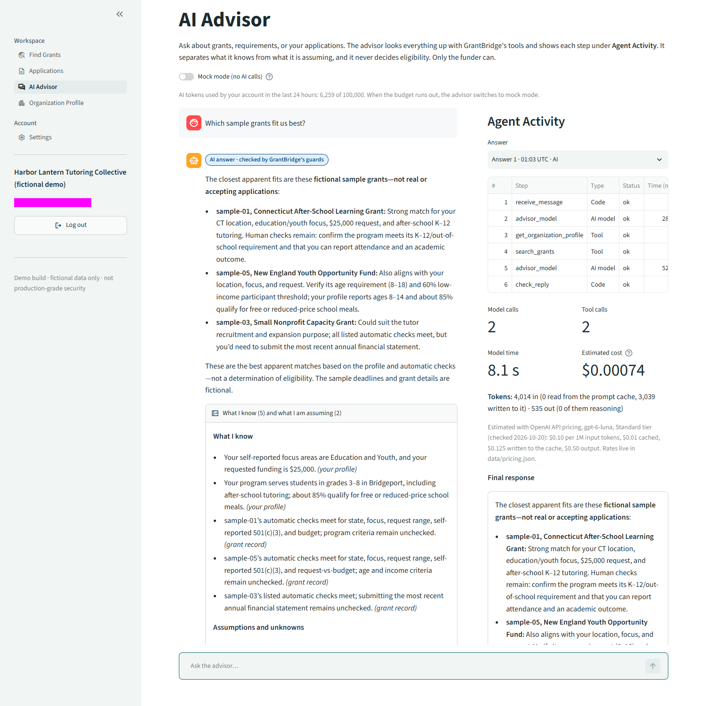

# GrantBridge tokenomics

What each AI run costs, what that means per user per month and at 100 and 10,000 users, and one measured cost reduction with its effect on answer quality.

Every token count here is the provider's own usage report for a real call to gpt-6-luna through the course Portkey key. Costs are estimates at OpenAI's published list price. Nothing is invented: a call that does not report usage is shown as "not reported" and gets no cost.

## Summary

Measured on 2026-10-21 (UTC) with gpt-6-luna, with GrantBridge's current default settings:

| Workflow | Cost per run | Time |
|---|---|---|
| Explain fit (1 model call) | $0.00033 | 3.8 s |
| Advisor answer (about 3 model calls, 2 tool calls) | $0.00059 | 7.6 s |
| Draft one answer (find facts, draft, review: 3 AI runs) | $0.00134 | 21.8 s |

| Scale (assumed use below) | Model cost per month |
|---|---|
| One active nonprofit account | $0.044 |
| 100 accounts | $4.38 |
| 10,000 accounts | $438 |

**The cost cut.** Asking gpt-6-luna for *low* reasoning effort, one setting that is now the default, cut the monthly cost by **23%** ($569 → $438 at 10,000 accounts). Every workflow also got faster: Explain fit went from 7.9 s to 3.8 s, and drafting from 38 s to 22 s. Quality held. On the same test cases the same 159 deterministic checks passed 152 times before and 151 times after (details in section 7).

**With the newer features** (proposal review, revisions, budget narratives, pursuit assessments, and mission-drift checks, measured the same day): **$0.058 per account per month, $5.75 for 100 accounts, and $575 for 10,000** (section 6b). **With Can We Afford to Win?** as well: **$0.060, $5.99, and $599** (section 6c).

Data: [`tokenomics/measurements-2026-10-21.json`](tokenomics/measurements-2026-10-21.json) has every call. [`tokenomics/cost-report-2026-10-21.md`](tokenomics/cost-report-2026-10-21.md) is the generated report.

## 1. What every real run records

Each AI action (Explain fit, an advisor answer, finding facts, a draft, a review) is one *run* in the privacy-safe trace (`grantbridge/trace.py`, tables `agent_runs` and `agent_steps`). Each model call in a run records:

| Field | Where it comes from |
|---|---|
| Model requested, and the snapshot that answered | the request; the `x-ms-served-model` response header (for example `gpt-6-luna-2026-09-22`) |
| Input tokens | `usage.input_tokens` |
| Cached input tokens (read from the prompt cache) | `usage.input_tokens_details.cached_tokens` |
| Input tokens written to the prompt cache | `usage.input_tokens_details.cache_write_tokens` |
| Output tokens, and how many were reasoning | `usage.output_tokens`, `usage.output_tokens_details.reasoning_tokens` |
| Whether usage was reported | `reported`, `no cache detail` (totals only), or `not reported` |
| Portkey's cache result | the `x-portkey-cache-status` response header (`MISS`, `HIT`, `REFRESH`) |
| Estimated cost, and the rates it used | `grantbridge/pricing.py` with `data/pricing.json` |
| Latency | the call's time, and the run's total time |

Each run also records how many model calls and tool calls it made. Prompts, replies, and profile text are never recorded.

**Where you see it:**

- **AI Grant Advisor → Technical details:** model calls, tool calls, model time, and estimated cost for each answer. Below that, the token breakdown (cache reads, cache writes, reasoning) and the source of the rates.
- **Find Grants:** each AI fit explanation ends with its model, tokens, estimated cost, and time.
- **Applications:** each AI draft and AI review shows the same line.
- **Account → Technical details: your AI usage and estimated cost:** totals for the last 24 hours and a table of recent AI runs (model, model calls, tool calls, tokens, time, cost).



**When usage is missing.** If a response has no usage, the call is stored as `not reported`. Its tokens show as "not reported" and its cost as "not estimated", never as zero. A model call that fails before any response gets the same treatment. Tests: `tests/test_costs.py`.

## 2. Prices: source and date

`data/pricing.json` holds the rates, the page they came from, and the date they were checked. Edit it, or point `GRANTBRIDGE_PRICING_FILE` at another file, when prices change. A model with no entry gets no estimate.

| gpt-6-luna, Standard tier, per 1M tokens | Up to 272K input tokens | Over 272K (applies to the whole request) |
|---|---|---|
| Input | $0.10 | $0.20 |
| Cached input (cache read) | $0.01 | $0.02 |
| Cache write (30-minute lifetime, the default) | $0.125 | $0.25 |
| Output (reasoning included) | $0.50 | $0.75 |

- **Source:** [OpenAI API pricing](https://developers.openai.com/api/docs/pricing), checked 2026-10-20. The [gpt-6-luna model page](https://developers.openai.com/api/docs/models/gpt-6-luna) lists the same rates.
- **Billing rules:** from OpenAI's [prompt-caching guide](https://developers.openai.com/api/docs/guides/prompt-caching) and [reasoning guide](https://developers.openai.com/api/docs/guides/reasoning). Cache reads and cache writes are both parts of `input_tokens`, and reasoning tokens are billed as output:

  ```
  cost = (input − cached − cache writes) × $0.10 + cached × $0.01 + cache writes × $0.125 + output × $0.50   (per 1M tokens)
  ```

- **Why OpenAI's price and not Azure's:** the course key sends gpt-6-luna to Azure OpenAI. The response headers show the model `gpt-6-luna-global`, served model `gpt-6-luna-2026-09-22`, region East US 2, pay-as-you-go. Azure's [pricing page](https://azure.microsoft.com/en-us/pricing/details/azure-openai/) lists GPT-6 Luna but shows every price as "$-" ("GPT-6 Sol and Luna prices are currently in processing for publishing on this page"). So OpenAI's list price is the only published rate. It is used for a global deployment, so no regional uplift (10%) is applied.
- **Portkey cache hits cost $0.** The course key has Portkey's response cache turned on. An identical request gets back a saved copy, marked `x-portkey-cache-status: HIT`, that never reaches Azure. Its usage numbers are copies of the original call's. GrantBridge records such a call as a cache hit, counts it at $0, and leaves it out of the daily budget.

## 3. What we learned about caching (probes on 2026-10-20)

Several small live calls with a fixed instruction block of about 2,400 tokens showed:

1. **Portkey replays identical requests.** A repeated identical call came back marked `HIT`, without any Azure headers, carrying the first call's usage numbers. Measurements must avoid this, or they double-count one real call. The measurement script sends Portkey's documented `x-portkey-cache-force-refresh: true` header, so every measured call is real.
2. **Azure's prompt cache works.** Forced past Portkey, an identical prompt read 2,416 tokens from the cache (`cached_tokens: 2416`, `cache_write_tokens: 0`).
3. **Every eligible prompt is written to the cache by default, at 1.25× the input price.** For a prompt that is never repeated within 30 minutes, that write is a 25% surcharge with no later saving. Prompts under 1,024 tokens are not cached at all.
4. **`prompt_cache_key` separates caches.** The same prompt under a new key started cold. GrantBridge now gives every account its own key (`grantbridge-<feature>-u<id>`). That stops one account from probing another's prompts through cache hits, and it gives each account honest cached-token counts.
5. **Changing the reasoning effort changes the cached prefix,** so a request with a different effort does not reuse the cache.

## 4. How the measurement works

`python -m scripts.measure_costs` runs three representative workflows through GrantBridge's own code, the same functions the pages call:

| Workflow | What runs | Test cases |
|---|---|---|
| Explain fit | one model call | sample-01 (passes every automatic check), sample-08 (fails the award-range check), sample-07 (fails the required state check) |
| Advisor answer | the agent loop with real tools (1–5 model calls) | "Which sample grants fit us best?", "What does the Connecticut After-School Learning Grant require?", "How far along are my applications?" |
| Draft one answer | three AI runs: find missing facts, draft, review | "Describe the after-school program this grant would support, including its schedule and staffing. (400 words)", with two added requirements |

- **Same inputs for every setting.** Each repetition of each setting uses a new sample account (the Harbor Lantern demo data) in a throwaway database, so every run starts with a cold prompt cache. Advisor questions are asked without earlier history. In the drafting case, every setting gets the same two answered facts.
- **Fresh answers only.** Live calls skip Portkey's response cache, and the report lists each call's cache status to prove it.
- **The same quality checks for every setting.** They are deterministic, so they are cheap and repeatable. For example: does the verdict agree with the automatic checks without correction, does the advisor call the tool the question needs, does every figure match a retrieved record, does the draft invent nothing and stay in the word limit, and is every review quote really in the answer.
- **Raw data:** every run's numbers are in `docs/tokenomics/measurements-<date>.json`, and the generated report is `docs/tokenomics/cost-report-<date>.md`.

## 5. Results: cost per run

Means over the measured cases: 9 per workflow and setting (3 cases × 3 repetitions), or 3 for drafting. The baseline is GrantBridge as first built, with no reasoning setting sent, so gpt-6-luna's default (medium) applies. "Low reasoning" is the cost cut, now the default. All 86 model calls reported usage, and none were Portkey cache hits.

| Workflow | Setting | Model calls | Tool calls | Input tokens | of which cached | written to cache | Output tokens | of which reasoning | Time | Cost per run (min to max) |
|---|---|---|---|---|---|---|---|---|---|---|
| Explain fit | baseline | 1.0 | 0 | 1,249 | 0 | 1,246 | 691 | 315 | 7.9 s | $0.00050 ($0.00039 to $0.00056) |
| Explain fit | **low reasoning** | 1.0 | 0 | 1,249 | 0 | 1,246 | 355 | 0 | 3.8 s | **$0.00033** ($0.00028 to $0.00038) |
| Advisor answer | baseline | 2.7 | 2.0 | 4,317 | 1,118 | 2,220 | 588 | 152 | 8.4 s | $0.00068 ($0.00036 to $0.00096) |
| Advisor answer | **low reasoning** | 2.9 | 2.0 | 4,643 | 1,445 | 2,219 | 406 | 0 | 7.6 s | **$0.00059** ($0.00037 to $0.00075) |
| Draft one answer | baseline | 3.0 | 0 | 3,417 | 0 | 2,480 | 3,125 | 1,813 | 38.1 s | $0.00197 ($0.00185 to $0.00207) |
| Draft one answer | **low reasoning** | 3.0 | 0 | 3,435 | 0 | 2,498 | 1,874 | 575 | 21.8 s | **$0.00134** ($0.00129 to $0.00138) |

**Where the money went (baseline, weighted by the monthly use below):**

| Token type | Share of cost |
|---|---|
| Visible output | 33% |
| Hidden reasoning (billed as output) | 27% |
| Cache writes (input billed at 1.25×) | 30% |
| Ordinary input | 9% |
| Cache reads (input billed at 0.1×) | 1% |

Output costs 5× as much as input, and more than a quarter of the whole bill was reasoning the user never sees. That is why the cut targets reasoning.

**Caching in practice.**
- Explain fit and drafting prompts are one-off. They are written to the cache and never read back.
- The advisor reuses its prefix between the model calls of one answer, so later calls read from the cache (26–31% of its input). Its first call, the instructions plus the five tool definitions plus the question, comes to just under the 1,024-token minimum, so that call is never cached.

## 6. Per user per month, and at 100 and 10,000 users

**Assumed use per active nonprofit account per month:**
- **20 Explain fit:** a part-time grant writer screens about 5 grants a week.
- **40 advisor answers:** about 10 questions a week.
- **10 drafted answers:** about 2 applications a month with 5 questions each, each question taken once through facts, draft, and review.

These are assumptions, not observed usage. The cost scales linearly, so the table also shows half and three times this use.

| | Light (half) | Typical | Heavy (3×) |
|---|---|---|---|
| Per account per month | $0.022 | **$0.044** | $0.131 |
| 100 accounts | $2.19 | **$4.38** | $13.14 |
| 10,000 accounts | $219 | **$438** | $1,314 |
| Baseline settings, typical use: 10,000 accounts | | $569 | |

This is model tokens only. Hosting, Portkey's plan, and Grants.gov (free) are not included.

**What the limits mean at this scale:**
- **Tokens:** typical use is about 287,000 tokens per account per month, roughly 9,600 a day.
- **Per-account cap:** the daily budget of 100,000 tokens caps any single account at about **$0.46 a month**, whatever it does.
- **Server-wide cap:** the default budget of 1,000,000 tokens a day covers only about **104 typical accounts**. Beyond that it switches everyone to mock mode. A deployment for 10,000 accounts would set `GRANTBRIDGE_SERVER_DAILY_TOKEN_BUDGET` to about 144,000,000 (the daily average plus 50% headroom). That cap allows at most about $22 a day.

## 6b. The newer AI features (measured 2026-10-21)

Measured with `python -m scripts.measure_new_features`: 5 workflows × 3 repetitions, each on a new sample account, with fresh answers only (no Portkey cache hits) and low reasoning effort. All 15 calls were live; none fell back to practice mode. Data: [`tokenomics/new-features-costs-2026-10-21.json`](tokenomics/new-features-costs-2026-10-21.json) and the generated [`.md`](tokenomics/new-features-costs-2026-10-21.md).

| Workflow | Model calls | Input tokens | of which cached | written to cache | Output tokens | of which reasoning | Time | Cost per run (min to max) |
|---|---|---|---|---|---|---|---|---|
| Proposal review | 1.0 | 2,066 | 0 | 2,063 | 1,161 | 85 | 10.1 s | $0.00084 ($0.00076 to $0.00096) |
| Revise one answer | 1.0 | 1,016 | 0 | 0 | 224 | 99 | 3.7 s | $0.00021 ($0.00019 to $0.00022) |
| Budget narrative | 1.0 | 1,244 | 0 | 1,241 | 498 | 223 | 7.2 s | $0.00040 ($0.00039 to $0.00043) |
| Pursuit assessment (fit evidence) | 1.0 | 1,136 | 0 | 1,133 | 300 | 0 | 3.8 s | $0.00029 ($0.00027 to $0.00032) |
| Mission drift | 1.0 | 1,218 | 0 | 1,215 | 770 | 238 | 11.2 s | $0.00054 ($0.00050 to $0.00056) |

**Assumed use per active account per month** (an assumption, like section 6): about two applications a month and ten grants screened. That means 4 proposal reviews, 6 revisions, 2 budget narratives, 10 pursuit assessments, and 10 mission-drift checks.

| | Newer features | First three workflows (section 6) | Total |
|---|---|---|---|
| Per account per month | $0.014 | $0.044 | **$0.058** |
| 100 accounts | $1.37 | $4.38 | **$5.75** |
| 10,000 accounts | $137 | $438 | **$575** |

The newer features add about 58,000 tokens per account per month. This is an upper bound for two of them: Should We Pursue? and the mission-drift check reuse their AI result at no cost when nothing they read has changed. The Portfolio Strategist and the workback timeline make no AI calls at all.

## 6c. Can We Afford to Win? (measured 2026-10-21)

Measured with `python -m scripts.measure_award_feasibility` (18:59 UTC): 5 sample notices × 3 repetitions of the term extraction, and 3 explanations of the sample demonstration. Every call was live, with fresh answers only; none fell back to practice mode. Data: [`evidence/award-feasibility-eval-2026-10-21.json`](evidence/award-feasibility-eval-2026-10-21.json) and the generated [`.md`](evidence/award-feasibility-eval-2026-10-21.md), which also scores every extracted term against the expected answers.

| Step | Runs | Input tokens | of which cached | Output tokens | of which reasoning | Time | Cost per run (min to max) |
|---|---|---|---|---|---|---|---|
| Read the award terms (one notice) | 15 | 740 | 0 | 396 | 117 | 4.2 s | $0.00027 ($0.00010 to $0.00043) |
| Explain the numbers | 3 | 1,557 | 0 | 253 | 0 | 5.8 s | $0.00032 |
| Cash simulation, verdict, what-if scenarios | — | — | — | — | — | — | $0 (code only) |

**Assumed use** (an assumption, like sections 6 and 6b): the award terms of 4 grants read and explained per account per month, about 12,000 tokens.

| | Can We Afford to Win? | Everything else (sections 6 and 6b) | Total |
|---|---|---|---|
| Per account per month | $0.0024 | $0.058 | **$0.060** |
| 100 accounts | $0.24 | $5.75 | **$5.99** |
| 10,000 accounts | $24 | $575 | **$599** |

Reading the terms again costs nothing when the listing and notice have not changed: the saved terms are reused. Trying a what-if scenario never calls the model.

## 7. The cost cut: low reasoning effort

**What changed.** Every model call (advisor, explain, facts, draft, review) now sends `reasoning: {"effort": "low"}`. It is one setting:
- `GRANTBRIDGE_REASONING_EFFORT`, with the default `low`.
- `default` sends nothing (gpt-6-luna then uses medium).
- `medium` and `high` are also accepted.

Each model step records the effort it used (`reasoning_effort` in the trace). Code: `llm.reasoning_options()`. Tests: `tests/test_advisor.py`.

**Effect on cost and speed (same test cases):**

| Workflow | Cost per run | Output tokens | Reasoning tokens | Time | Quality checks passed |
|---|---|---|---|---|---|
| Explain fit | $0.00050 → $0.00033 (−33%) | 691 → 355 | 315 → 0 | 7.9 s → 3.8 s | 58/63 → 56/63 |
| Advisor answer | $0.00068 → $0.00059 (−13%) | 588 → 406 | 152 → 0 | 8.4 s → 7.6 s | 67/69 → 68/69 |
| Draft one answer | $0.00197 → $0.00134 (−32%) | 3,125 → 1,874 | 1,813 → 575 | 38.1 s → 21.8 s | 27/27 → 27/27 |
| **Month, 10,000 accounts** | **$569 → $438 (−23%)** | | | | **152/159 → 151/159** |

The advisor saves the least because its cost is mostly input: tool results passed back to the model.

**Effect on quality.** Every check is listed in the generated report. Where the two settings differed:

| Check | Baseline | Low reasoning |
|---|---|---|
| Explain fit: confidence fits the unchecked items (no cap needed) | 4/9 | 2/9 |
| Advisor: no sentence had to be removed (open-status or eligibility claims) | 8/9 | 9/9 |
| Advisor: stays within its 180-word limit | 8/9 | 9/9 |
| Advisor: names the grant it is about | 9/9 | 8/9 |

The other checks passed equally in both settings, including every check on drafting:
- the verdict agrees with the automatic checks
- the advisor looks up the right record
- every figure matches a retrieved record
- drafts invent no figures or names and stay within the word limit
- every review quote is really in the answer

Side by side:
- **Verdicts were the same** for sample-08 (possible fit) and sample-07 (unlikely fit). For sample-01, low reasoning said "likely fit" 3 of 3 times; the baseline said "likely" once and "possible" twice. Both are accepted.
- **Drafts were the same length** (190–215 words in the baseline, 195–224 with low reasoning, against a 400-word limit), with the same facts.
- **Advisor answers were slightly shorter** (110 words on average in the baseline, 99 with low reasoning).

**The one consistent difference** is overconfidence in fit explanations. With low reasoning the model more often claimed "high" confidence while some requirements were still unchecked (7 of 9 explanations, against 5 of 9). GrantBridge's code guard already lowers that to "medium" every time, so users see the same confidence in both settings. The single unnamed grant was an answer that said "the sample grant" for the one the user had just named.

**Decision:** low reasoning is the default. It is 23% cheaper, Explain fit is twice as fast, and drafting takes 43% less time. No check that protects the user got worse.

**Example: the same case in both settings** (sample demo data; more in the generated report):

> **Explain fit, sample-01, baseline:** "likely fit (confidence medium). The tutoring program appears to match the sample grant's Connecticut, education, student-age, and funding criteria. This is a sample for the demo, not a real opportunity…"
>
> **Low reasoning:** "likely fit (confidence medium). The tutoring program appears closely aligned with this sample grant's Connecticut, after-school education focus and listed award range. This is a sample for the demo, not a real opportunity."

## 8. Other cost findings and next steps

- **An earlier cut (2026-10-20):** limiting how many grants the advisor inspects per answer took "Which sample grants fit us best?" from 9,804 to 6,301 tokens (−36%), with the same top three grants.
- **Cache writes are now 40% of the cost, and most are never read.** Writing costs 1.25× the input rate, so the premium alone is about 8% of the monthly bill. Most of it comes from one-off prompts (Explain fit, drafting) that are never repeated within 30 minutes.
  - *Next step:* send those calls with `prompt_cache_options: {"mode": "explicit"}` and no breakpoints, which turns caching off for them. That saves about 2–3% a month for those two workflows. Not built: it first needs a check that Azure accepts the option.
- **The advisor's first model call is never cached.** It is just under the 1,024-token minimum, so the second call cannot reuse it and writes it again.
  - *Next step:* once the stable prefix (instructions and tool definitions) is at least 1,024 tokens and marked with an explicit cache breakpoint, later calls in an answer would read it at 0.1× instead of writing it at 1.25×. That is an estimated 10–15% off multi-call answers. Needs the same before/after quality check.
- **Search results are the advisor's biggest input.** Six grants with all their checks come to about 1,500 tokens per search (estimated at 4 characters per token). The profile tool adds about 500.
  - *Next step:* return the top 3 instead. That is about 700 fewer input tokens, roughly 10–12% of a "which grants fit" answer, but it needs the quality check, since the advisor would see fewer options.
- **Identical requests are already free.** Portkey answers them from its response cache, and GrantBridge counts them at $0.

## 9. Limits of these numbers

- **Small samples from one day.** Reasoning varies a lot between identical calls: Explain fit output ranged from 454 to 814 tokens in the baseline. The min-to-max ranges in section 5 show it.
- **List price, not the course's actual bill.** Azure has not published its GPT-6 Luna rates yet, and the course account may be billed differently.
- **Model tokens only.** No hosting or gateway fees.
- **The usage pattern is assumed.** The light and heavy columns show how the totals scale.
- **The quality checks are deterministic and narrow.** They catch rule-breaking and grounding errors, not writing quality. The raw data keeps every answer for a person to compare.
- **A first comparison was thrown away.** Its first baseline repetition read prompt caches that an exploratory run had written minutes earlier. Every new database numbers its first account 1, so the per-account cache keys matched. GrantBridge now mixes a random per-installation id into every cache key. The comparison was then rerun with every run starting cold, and the report lists each call's cache status as proof.

## 10. Reproduce

```bash
python -m pytest tests/test_costs.py                 # offline: pricing, usage handling, cost per run, the harness
python -m scripts.measure_costs --offline            # no AI calls; scripted model with made-up counts
python -m scripts.measure_costs                      # live: about 160,000 tokens (~$0.03), about 13 minutes
python -m scripts.measure_costs --from-json docs/tokenomics/measurements-2026-10-21.json   # rebuild the report
python -m scripts.measure_new_features --offline     # no AI calls: tests the newer-features harness
python -m scripts.measure_new_features               # live: 15 model calls (about $0.007), about 2 minutes
python -m scripts.measure_award_feasibility --offline   # no AI calls: the practice patterns only
python -m scripts.measure_award_feasibility           # live: 18 model calls (about $0.005), a few minutes
```
